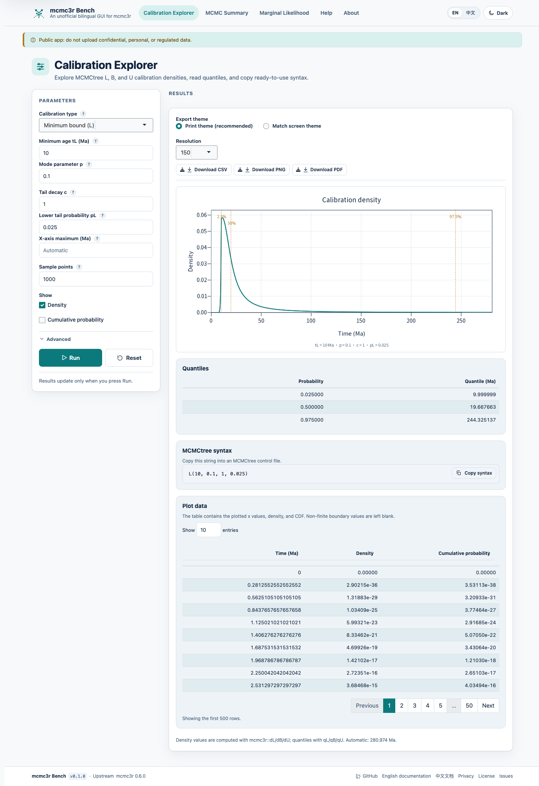

# mcmc3r Bench

**An independent, unofficial, bilingual Shiny GUI for the `mcmc3r` R package.**

[English](README.md) | [中文](README.zh-CN.md)

[](VERSION)
[](LICENSE)
[](docs/README.md)
[](https://zengzichao-mcmc3r-bench.share.connect.posit.cloud/)

mcmc3r Bench wraps three `mcmc3r` workflows in a web interface:

- **Calibration Explorer**: L/B/U densities, cumulative probabilities,
  quantiles, MCMCtree syntax, PNG/PDF/CSV exports.
- **MCMC Summary**: MCMCtree `t_` and BPP `tau_` outputs, missing-value
  handling, CSV exports.
- **Marginal Likelihood**: stepping stones and Gauss–Legendre quadrature, ZIP or
  individual chain files, logML/SE, summary/detail CSV, plot PNG/PDF, and
  reproducible bundles.

The interface supports English/Chinese and light/dark themes, both persisted
independently. Calculations are performed by the upstream package; the GUI adds
validation, explanations, themes, error codes, and documentation.



## Live demo

<https://zengzichao-mcmc3r-bench.share.connect.posit.cloud/>

The app is hosted on Posit Connect Cloud. The Free plan serves public content
and allows a 1 GiB bundle; compute and usage limits follow the account plan
(see <https://connect.posit.cloud/plans>). If the app is unavailable or the
quota is exhausted, run it locally.

> **Public app:** do not upload confidential, personal, or regulated data.

## Quick start (local)

```bash
cd mcmc3r-Bench
Rscript -e 'renv::restore()'
Rscript -e 'shiny::runApp(".")'
```

Requirements: R 4.6.1, a working toolchain for compiled packages, and network
access to CRAN and GitHub. The upstream `mcmc3r` package must be installed from
the pinned GitHub commit. For an offline development setup, install the local
snapshot into `.Rlib` and use the project `.Rprofile`:

```bash
R CMD INSTALL --library=.Rlib ../mcmc3r-原始代码
Rscript -e 'shiny::runApp(".")'
```

See [QUICKSTART.md](docs/en/QUICKSTART.md) for details.

## Features

| Module | Highlights |
|---|---|
| Calibration Explorer | L/B/U densities, CDF, quantiles, MCMCtree syntax, print/screen exports, 150/300 dpi PNG, PDF |
| MCMC Summary | Auto/manual `t_`/`tau_` prefix, column preview, non-finite row report, CSV |
| Marginal Likelihood | Stepping stones, Gauss–Legendre, ZIP safety, per-beta diagnostics, summary/detail CSV, PNG/PDF plot, bundle download |
| Help / About | Methods, formats, all error codes, privacy, citation, licences, version metadata |
| Global | EN/中文, light/dark, `?lang=`/`?theme=`, keyboard support, ARIA labels, copy diagnostics |

## Inputs

- `mcmc.txt`: header, whitespace/tab/comma, at least two rows, `t_` (MCMCtree)
  or `tau_` (BPP).
- `beta.txt`: one value per line, strictly increasing, no 1.
- Chain ZIP: `beta.txt` plus `1/mcmc.txt` … `n/mcmc.txt`; one optional outer
  folder.
- Individual chain files: one per beta point.

Full specifications: [FILE_FORMATS.md](docs/en/FILE_FORMATS.md).

## Methods and citation

The GUI does not introduce statistical methods. Cite the method paper(s) for
your workflow, the `mcmc3r` package, and optionally this software:

- Yang & Rannala (2006), DOI 10.1093/molbev/msj024
- Inoue, Donoghue & Yang (2010), DOI 10.1093/sysbio/syp078
- dos Reis et al. (2018), DOI 10.1093/sysbio/syy001
- Rannala & Yang (2017), DOI 10.1093/sysbio/syw119
- dos Reis M, Alvarez-Carretero S. (2025). *mcmc3r* (Version 0.6.0).

See [METHODS.md](docs/en/METHODS.md) and [CITATION.cff](CITATION.cff).

## Deployment

The app is a standard Shiny application with `renv.lock`, deployed to Posit
Connect Cloud. Deployment instructions, limits, rollback, and troubleshooting
are in [DEPLOYMENT.md](docs/en/DEPLOYMENT.md). The CI deploy workflow is manual
and requires the `production` environment.

## Repository layout

```
app.R, global.R, VERSION
R/                 modules, services, i18n, errors, files, plots, theme
i18n/              translations.csv, help_en.md, help_zh.md
www/               CSS, JS, images, Noto Sans SC
tests/             testthat, shinytest2, fixtures
dev/               build, check, benchmark, screenshot, deploy scripts
docs/              EN/ZH documentation trees and screenshots
.github/           CI, deploy, issue/PR templates
```

## Documentation

- [Documentation index](docs/README.md)
- [User guide](docs/en/USER_GUIDE.md)
- [File formats](docs/en/FILE_FORMATS.md)
- [Methods](docs/en/METHODS.md)
- [FAQ](docs/en/FAQ.md)
- [Privacy](docs/en/PRIVACY.md)
- [Architecture](docs/en/ARCHITECTURE.md)
- [Testing](docs/en/TESTING.md)

## Author and attribution

**Project author and maintainer:** Zeng Zichao (曾子超),
`zengzichao@sjtu.edu.cn`, ORCID
[0000-0001-6553-970X](https://orcid.org/0000-0001-6553-970X),
GitHub [@ZengZichao](https://github.com/ZengZichao).

Built on `mcmc3r` by Mario dos Reis, Sandra Alvarez-Carretero, and contributors
(MIT). mcmc3r Bench is an independent, unofficial GUI. It is not affiliated
with or endorsed by the `mcmc3r` authors, MCMCtree, or BPP. The upstream authors
did not participate in the design, implementation, or deployment of this GUI.

## Licence

- Code: MIT (see [LICENSE](LICENSE)).
- Original documentation: CC BY 4.0 (see [docs/LICENSE](docs/LICENSE)).
- Upstream `mcmc3r`: MIT, Copyright 2017 Mario dos Reis.
- Noto Sans SC: SIL Open Font License 1.1 (see [www/fonts/OFL.txt](www/fonts/OFL.txt)).

See [NOTICE](NOTICE) and [THIRD_PARTY_LICENSES.md](THIRD_PARTY_LICENSES.md).

## Contributing, security, conduct

- [CONTRIBUTING.md](CONTRIBUTING.md)
- [SECURITY.md](SECURITY.md)
- [CODE_OF_CONDUCT.md](CODE_OF_CONDUCT.md)

## Disclaimer

The software is provided “as is”, without warranty. The hosted app has no SLA;
quota, cold start, or platform changes may affect availability. Users are responsible
for input data, parameter choices, and interpretation. This app does not replace
MCMCtree/BPP convergence diagnostics or model checking.
